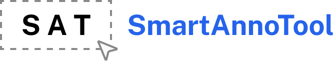
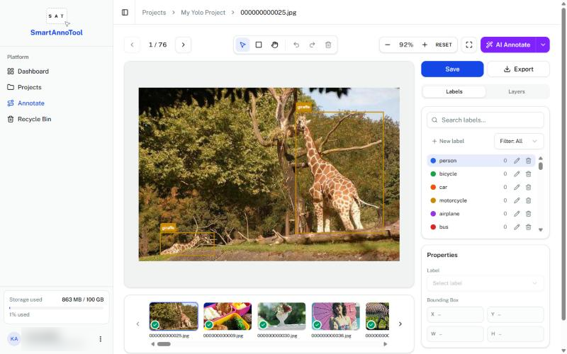
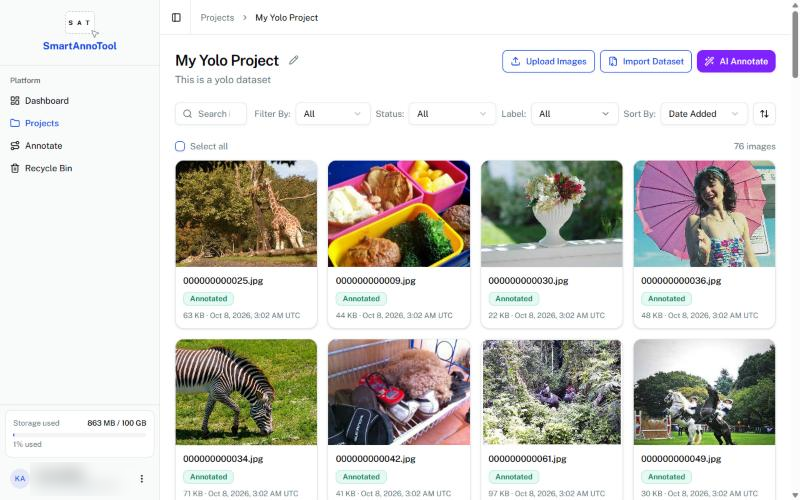
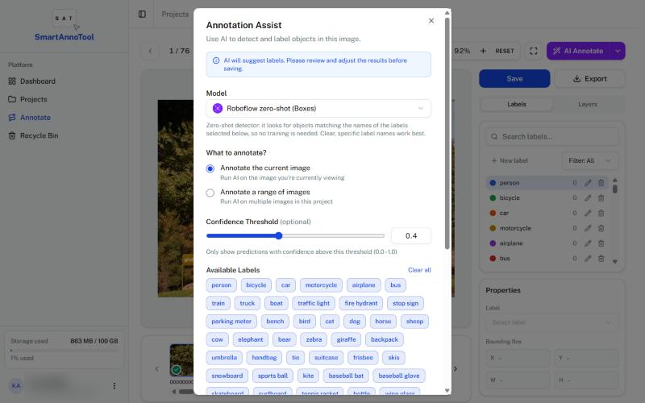
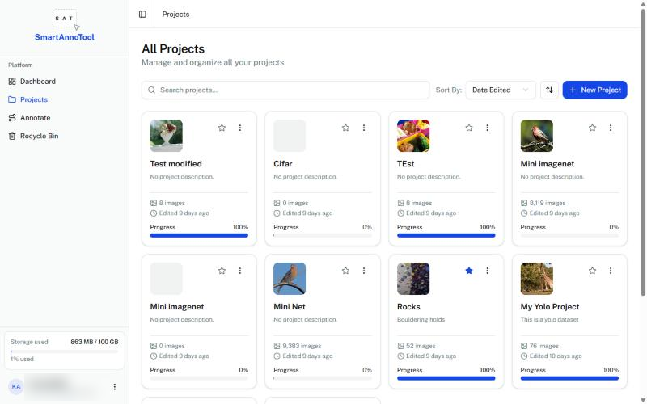
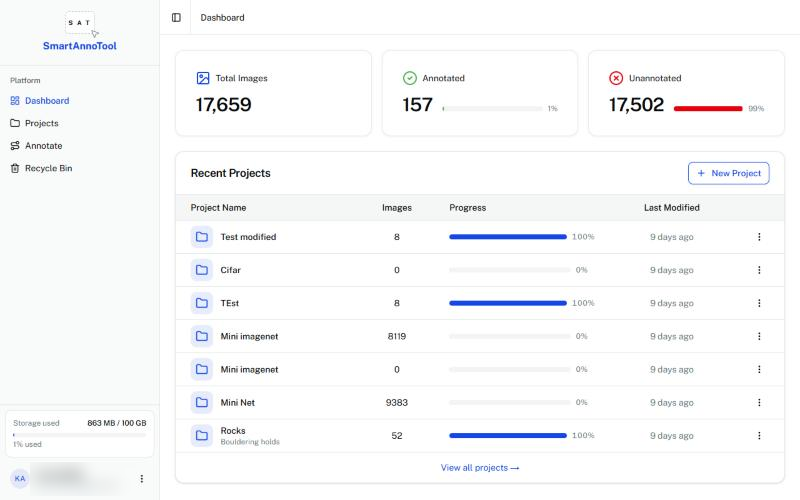
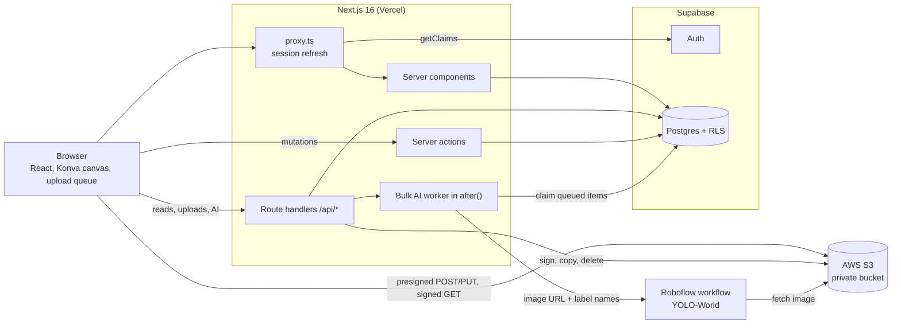

<h1 align="center">
  <picture>
    <source media="(prefers-color-scheme: dark)" srcset="docs/logo-dark.png">
    
  </picture>
</h1>

<p align="center">
  <strong>Build object-detection datasets in the browser.</strong><br>
  Upload images, draw bounding boxes, let a zero-shot model propose boxes, and export to COCO, YOLO or Pascal VOC.
</p>

<p align="center">
  
  
  
  
  
</p>

<p align="center">
  <a href="#features">Features</a> ·
  <a href="#architecture">Architecture</a> ·
  <a href="#getting-started">Getting started</a> ·
  <a href="#deployment">Deployment</a> ·
  <a href="#project-structure">Project structure</a>
</p>



SmartAnnoTool is a web app for labelling image datasets. Each user owns projects; each project holds images (stored in S3), a set of labels, and the bounding boxes drawn on each image. An AI Annotate feature runs zero-shot detection (YOLO-World on Roboflow) against the project's own label names, so it needs no training. A person reviews every AI suggestion before it is saved. It was built as a FIT3162 final-year project at Monash University and is deployed at [dataannotationtool.vercel.app](https://dataannotationtool.vercel.app).

## Features

- **Projects:** create, star, search, sort, duplicate, and copy images between projects. The dashboard shows annotated and unannotated image counts, and the sidebar shows storage used.
- **Uploads:** JPEG and PNG files or ZIP archives up to 15 GB each go straight from the browser to S3. Uploads keep running in the background while you use the rest of the app, with a time-left estimate.
- **Annotation workspace:** draw, move and resize bounding boxes; manage per-project labels; layers, undo and redo, keyboard shortcuts, and auto-save.
- **AI Annotate:** detect objects in one image, or queue a bulk run over up to 2,000 images. Suggestions appear as dashed boxes that you accept, relabel or discard.
- **Import:** annotated datasets in COCO, YOLO (`classes.txt` or `data.yaml`) and Pascal VOC formats. Each archive is validated and previewed before anything is written.
- **Export:** COCO JSON, YOLO ZIP or Pascal VOC ZIP, with or without the images.
- **Recent Annotations:** recently annotated images across all projects, with move, copy, export and delete.
- **Recycle Bin:** deleted projects and images can be restored for 30 days.

<table>
  <tr>
    <td width="50%"></td>
    <td width="50%"></td>
  </tr>
  <tr>
    <td align="center">Project images</td>
    <td align="center">AI Annotate</td>
  </tr>
  <tr>
    <td width="50%"></td>
    <td width="50%"></td>
  </tr>
  <tr>
    <td align="center">Projects</td>
    <td align="center">Dashboard</td>
  </tr>
</table>

## Architecture



| Layer | Technology |
|-------|------------|
| App | Next.js 16 App Router with `cacheComponents`, React 19, TypeScript |
| Auth and database | Supabase Auth (email/password, Google OAuth) and Postgres with row-level security |
| Image storage | AWS S3, private bucket, presigned uploads and signed read URLs |
| AI detection | Roboflow Workflows running YOLO-World zero-shot detection |
| Canvas | Konva via `react-konva` |
| UI | Tailwind CSS v4, shadcn/ui, lucide-react, ThumbHash image placeholders |

### How the main flows work

| Flow | What happens |
|------|--------------|
| Auth | `proxy.ts` refreshes the Supabase session cookie on every request and sends signed-out users to `/auth/login`. |
| Page loads | Server components load data in parallel and pass it to client components. Suspense skeletons are prerendered, so navigation shows the page shape at once. |
| Uploads | The browser asks `/api/uploads/*` for a presigned POST (files up to 8 MiB) or multipart part URLs, sends the bytes directly to S3, then commits the image rows. Image bytes never pass through Next.js. |
| Annotation | Canvas edits update a local editor model with undo history. Changes auto-save 1.5 s after the last edit, through a serial queue, to the `saveImageAnnotations` server action. |
| AI Annotate (one image) | `/api/annotations/auto-label` signs a short-lived S3 URL and sends it, with the project's label names, to the Roboflow workflow. The boxes come back as suggestions for review. |
| AI Annotate (bulk) | `/api/annotations/jobs` writes one Postgres row per image; that table is the queue. A worker started with `after()` claims rows with `FOR UPDATE SKIP LOCKED` and runs four detections at a time. The page polls progress every 2.5 s and restarts the worker if it has stopped. |
| Recycle Bin | Postgres functions snapshot deleted rows into `recycle_bin_items` and keep the S3 objects. Permanent deletion, or expiry after 30 days, removes the objects and then the rows. |

### Data model

| Table | Holds |
|-------|-------|
| `projects` | Name, description, starred flag, owner (`user_id`) |
| `images` | S3 object key, size, content type, ThumbHash, and `annotation` (JSONB array of boxes) |
| `project_labels` | Label names and colours for each project |
| `annotation_jobs`, `annotation_job_items` | Bulk AI runs. Items are the work queue and hold pending suggestions |
| `recycle_bin_items` | Snapshots of deleted projects and images, with a 30-day expiry |

Every query runs as the signed-in user with the publishable key. RLS limits each user to their own projects and everything inside them, and the app uses no service-role key. S3 objects are never public.

## Getting started

### Prerequisites

- [Node.js](https://nodejs.org) 22 or later, and npm
- A [Supabase](https://supabase.com) project
- An AWS account with an S3 bucket and an IAM user
- A [Roboflow](https://roboflow.com) workspace (optional, only for AI Annotate)

### 1. Install

```bash
git clone https://github.com/Kaiz404/Intelligent-Data-Labelling-and-Annotation-Tool.git
cd Intelligent-Data-Labelling-and-Annotation-Tool
npm ci
cp .env.example .env
```

### 2. Configure environment variables

Fill in `.env`:

| Variable | Required | Description |
|----------|----------|-------------|
| `NEXT_PUBLIC_SUPABASE_URL` | Yes | Supabase project URL |
| `NEXT_PUBLIC_SUPABASE_PUBLISHABLE_KEY` | Yes | Supabase publishable (or legacy anon) key |
| `AWS_REGION` | Yes | Region of the bucket, for example `ap-southeast-2` |
| `AWS_S3_BUCKET` | Yes | Bucket that stores project images |
| `AWS_ACCESS_KEY_ID`, `AWS_SECRET_ACCESS_KEY` | Yes | Static keys of the IAM user below. The app does not use the default AWS credential chain |
| `STORAGE_QUOTA_GB` | No | Quota shown in the sidebar storage widget. Default `100` |
| `ROBOFLOW_API_KEY` | For AI | Roboflow workspace API key |
| `ROBOFLOW_API_URL` | For AI | `https://serverless.roboflow.com` |
| `ROBOFLOW_WORKSPACE` | For AI | Workspace slug that owns the workflow |
| `ROBOFLOW_WORKFLOW_ID` | For AI | Workflow ID, `gateway-zero-shot-detect` by default |
| `ROBOFLOW_CONFIDENCE` | No | Default confidence threshold from 0 to 1. Default `0.4` |

> [!CAUTION]
> AWS and Roboflow keys are server-only. Never give them a `NEXT_PUBLIC_` prefix, because Next.js would bundle them into browser code.

### 3. Set up Supabase

Apply the schema in [`supabase/migrations/`](supabase/migrations) to your project. You will need its project ref (from the dashboard URL) and database password:

```bash
npx supabase login
npx supabase link --project-ref <your-project-ref>
npx supabase db push
```

Then, in the Supabase dashboard:

1. **Authentication → URL Configuration:** set the Site URL to your app's URL and add `http://localhost:3000/**` and `https://<your-domain>/**` to Redirect URLs.
2. **Email confirmations:** if "Confirm email" is on, change the *Confirm signup* template link to:
   ```text
   {{ .SiteURL }}/auth/confirm?token_hash={{ .TokenHash }}&type=email&next=/dashboard
   ```
   The `/auth/confirm` route expects `token_hash` and `type`, which the default template does not send.
3. **Google sign-in (optional):** enable the Google provider with a Google Cloud OAuth client whose redirect URI is `https://<project-ref>.supabase.co/auth/v1/callback`. Email and password sign-in works without it.

### 4. Set up S3

Create a bucket and keep **Block Public Access** on; the app serves every image through signed URLs. Images are stored under `projects/{projectId}/images/` and project thumbnails at `projects/{projectId}/thumbnail`.

Give the IAM user this policy (replace `YOUR_BUCKET`):

```json
{
  "Version": "2012-10-17",
  "Statement": [
    {
      "Effect": "Allow",
      "Action": ["s3:PutObject", "s3:GetObject", "s3:DeleteObject", "s3:AbortMultipartUpload"],
      "Resource": "arn:aws:s3:::YOUR_BUCKET/projects/*"
    },
    {
      "Effect": "Allow",
      "Action": "s3:ListBucket",
      "Resource": "arn:aws:s3:::YOUR_BUCKET",
      "Condition": { "StringLike": { "s3:prefix": "projects/*" } }
    }
  ]
}
```

`s3:ListBucket` is only used to measure storage. Without it, the sidebar estimates usage from the database.

Set the bucket's CORS configuration. The browser uploads with POST and PUT, and it needs to read `ETag` to complete multipart uploads:

```json
[
  {
    "AllowedOrigins": ["http://localhost:3000", "https://your-domain.example"],
    "AllowedMethods": ["GET", "HEAD", "PUT", "POST"],
    "AllowedHeaders": ["*"],
    "ExposeHeaders": ["ETag"],
    "MaxAgeSeconds": 3600
  }
]
```

### 5. Set up Roboflow (optional)

One shared Roboflow workflow serves every project, because each request sends that project's label names. Create a workflow in your workspace with:

- Inputs `image`, `class_names` (list of strings) and `confidence` (number)
- A YOLO-World object detection block that uses those inputs
- One output named `predictions`, holding the block's predictions

Name it `gateway-zero-shot-detect` or set `ROBOFLOW_WORKFLOW_ID` to its ID. Without Roboflow the rest of the app works, and AI Annotate reports that it is not configured.

### 6. Run

```bash
npm run dev
```

Open <http://localhost:3000>, sign up, and create a project.

> [!TIP]
> Supabase redirects only to origins in the allow list. If you browse at `127.0.0.1:3000`, add that origin too.

### Scripts

| Command | Description |
|---------|-------------|
| `npm run dev` | Start the development server |
| `npm run build` | Build for production |
| `npm run start` | Serve the production build |
| `npm run lint` | Run ESLint |
| `node --test "lib/**/*.test.mjs" "components/**/*.test.mjs"` | Run the unit tests. They need no database, S3 or network |

## Deployment

Production runs on [Vercel](https://vercel.com) with no `vercel.json`:

1. Import the repository into Vercel. The Next.js preset needs no changes.
2. Add every variable from [step 2](#2-configure-environment-variables). Set the `NEXT_PUBLIC_*` values before the first build, because Next.js inlines them at build time.
3. Add the production domain to Supabase's Site URL and Redirect URLs, and to the S3 CORS `AllowedOrigins`.
4. Apply the migrations to the production Supabase project with `npx supabase db push` ([step 3](#3-set-up-supabase)).

> [!IMPORTANT]
> The bulk AI routes set `maxDuration = 300` and run their worker in `after()`, so your plan must allow 300-second functions. There is no cron or external queue. A bulk run advances while the project page or workspace is open in a tab, and resumes on the next visit. Likewise, a user's expired Recycle Bin items are purged when that user opens `/recycle-bin`.

Any Node.js host that can run `next start` also works.

## Project structure

```text
app/
  (app)/          Signed-in pages: dashboard, projects, annotation workspace, recent annotations, recycle bin
  api/            Route handlers: S3 uploads, AI annotate and bulk jobs, project export and thumbnails
  auth/           Login, sign-up, password reset, OAuth and email-confirm handlers
components/       Feature UI by area; components/ui holds shadcn/ui primitives
hooks/            Client hooks: upload queue, AI job polling, serial save queue, URL state
lib/
  actions/        Server actions: projects, images, labels, annotations, suggestions, recycle bin
  annotations/    Editor model, dataset import parsers, export serializers, AI auto-label, bulk job worker
  roboflow/       Roboflow workflow client
  supabase/       Browser and server clients, session proxy, row paging helpers
  uploads/        Direct-to-S3 uploader, upload queue, ZIP readers, dataset import runner
  types/          Shared TypeScript types
docs/             README images
supabase/         Supabase CLI config and database migrations
proxy.ts          Session refresh and auth redirects (Next.js 16 replacement for middleware.ts)
```

For more detail, read [AGENTS.md](AGENTS.md), the contributor reference that covers conventions, every route, server action and table, and the full status of each feature. The research behind the AI feature is in [AI_AUTO_LABELING_RESEARCH.md](AI_AUTO_LABELING_RESEARCH.md), [ROBOFLOW_HOSTED_IMPLEMENTATION_PLAN.md](ROBOFLOW_HOSTED_IMPLEMENTATION_PLAN.md) and [ZERO_SHOT_SCALING_RESEARCH.md](ZERO_SHOT_SCALING_RESEARCH.md).

## Limitations

- Bounding boxes only; there are no polygons, masks or classification labels.
- Images must be JPEG or PNG.
- Uploads and dataset imports do not resume after a page reload.
- Bulk AI runs need an open tab to advance (see [Deployment](#deployment)).
